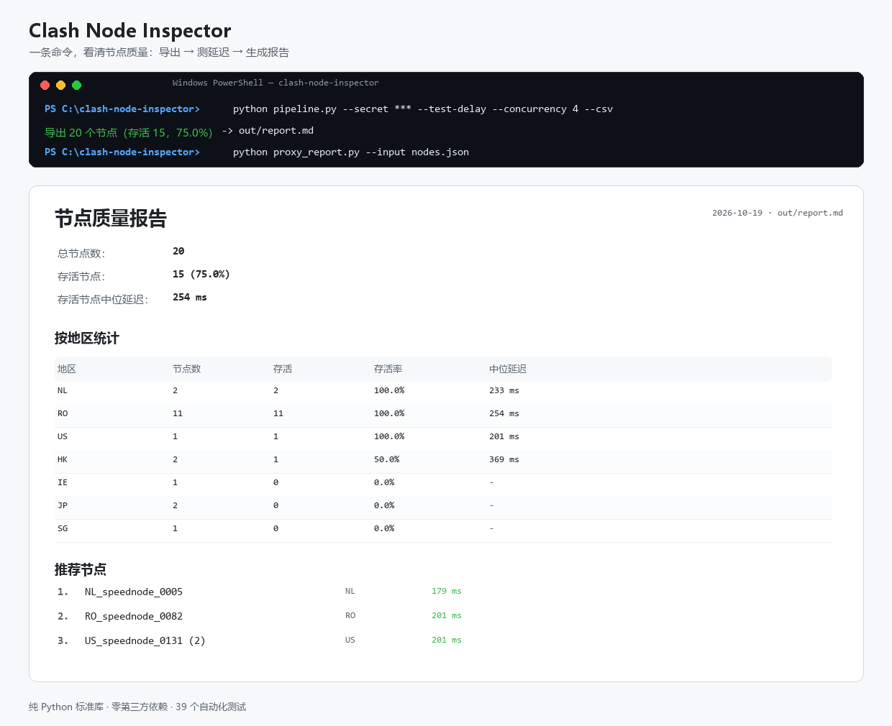

# Clash Node Inspector

[](LICENSE)
[](https://www.python.org/)
[](#测试)

> 一条命令，看清你的 Clash / mihomo 节点今天到底能不能用。

仓库地址：https://github.com/minj65446-ops/clash-node-inspector

```bash
git clone https://github.com/minj65446-ops/clash-node-inspector.git
cd clash-node-inspector
```

免费节点、共享订阅的通病是：**名字写着"香港"，实际出口在芬兰；延迟测出来 200ms，真实流量却一个字节都过不去。**

这个工具从 Clash 控制器的 REST API 拉取节点，做真实延迟测试与地区识别，生成 Markdown 质量报告，
并用每日巡检维护一份趋势表。纯 Python 标准库，零第三方依赖。



## 特性

- 🔍 从 Clash / mihomo 外部控制器拉取节点（支持密钥认证）
- 🌍 28 个地区的识别（香港/新加坡/日本/美国/荷兰/罗马尼亚……），并避免 `Russia` 被误判为 `US` 这类问题
- ⚡ 并发延迟测试（默认 1，最高 16），实测 20 节点从 25.5s 降到 7.1s
- 🔁 失败重试（`--retry 0..5`），只对失败节点重试，401 不重试
- 📊 Markdown 报告：存活率、各地区的存活率与中位延迟、Top3 推荐节点
- 🧹 策略过滤：`--dedupe` 归并重复节点，`--keep-region` / `--exclude-region` / `--max-delay` / `--only-alive`
- ✂️ 配置裁剪：`clash_prune.py` 按巡检结果删掉失效节点、清理变空的策略组（绝不改注释与其它分节）
- 🎯 按真实出口去重：`--profile` 读配置里的 `server:port`，同机换名也能识别
- 🗂 每日巡检：按日期归档、维护 `history.jsonl` 与趋势表 `index.md`、低于阈值告警
- 📄 CSV 导出，方便导入 Excel
- ✅ 59 个自动化验收测试

## 环境要求

- Python 3.8+（只用标准库）
- Clash Verge Rev / mihomo 等带 **外部控制器** 的 Clash 内核
  - 默认地址 `http://127.0.0.1:9097`
  - 在 Clash Verge 里：`设置 → 外部控制`，复制端口与密钥
  - 或在 `clash-verge.yaml` 里查看 `external-controller` 与 `secret`

## 快速开始

```bash
# 1) 拉取 + 测延迟，生成 JSON 与 CSV
python pipeline.py --secret <你的密钥> --test-delay --concurrency 4 --retry 1 --csv --output-dir out

# 输出：
#   导出 20 个节点（存活 15），报告: out/report.md

# 2) 只看报告
cat out/report.md
```

单独使用两个子工具：

```bash
# 导出节点 JSON（可配合任意下游脚本）
python clash_export.py --secret <密钥> --test-delay --concurrency 4 --output nodes.json

# 从节点 JSON 生成 Markdown 报告
python proxy_report.py --input nodes.json --output report.md

# 机器可读版本（同源数据，便于接自动化）
python proxy_report.py --input nodes.json --json --output report.json
```

## 策略过滤与配置裁剪

巡检只能告诉你"哪些坏了"，下面这条命令把坏的直接从配置里摘掉：

```bash
# 去重 + 只留可用的 + 延迟 ≤ 500ms + 把结果写回配置副本
python pipeline.py --secret <密钥> --test-delay --concurrency 8 \
  --dedupe --only-alive --max-delay 500 \
  --prune-profile profiles/free_nodes.yaml --prune-out profiles/free_nodes.pruned.yaml
# --prune-profile 同时充当去重的 server:port 来源，无需重复指定
```

也可以用 `clash_export.py` 单独过滤，再手动裁剪：

```bash
python clash_export.py --secret <密钥> --test-delay --concurrency 8 \
  --dedupe --keep-region HK,JP,SG --max-delay 400 --stats --output nodes.json

python clash_prune.py --profile profiles/free_nodes.yaml --nodes nodes.json --dry-run
python clash_prune.py --profile profiles/free_nodes.yaml --nodes nodes.json --in-place
```

- `--dedupe`：把 `X` 与 `X (2)` / `X #2` 归并，保留"无后缀且延迟最低"的那个
- `--profile <yaml>`：配合 `--dedupe`，从配置里读 `server:port`，按**真实出口**去重
  （`NL_speednode_0004` 与 `0005` 同机不同名也能识别）
- `--stats`：把原始数、保留数、每条剔除原因打到 stderr
- `--in-place`：覆盖前自动备份成 `<profile>.bak-<时间戳>`
- `clash_prune.py` 只做文本级最小手术：删除失效 `proxies` 条目、清理 `proxy-groups` 里的悬空成员、删掉变空的组；注释、缩进、其它分节逐字节保留

> 去重依据的优先级：`--profile` 能解析出 `server:port` 时按真实出口；解析不到（节点不在该配置里、
> 或用了 `use:` 引用远程 provider）时退回名称后缀归并。配置文件解析是文本级的，不依赖 YAML 库。

## 每日巡检

```bash
python daily_inspect.py
```

**Windows 用户**也可以直接双击 `一键巡检.cmd`：会自动设置 UTF-8 编码、检查 Python 是否安装、结束后暂停显示结果。

会做三件事：

1. 调用 `pipeline.py`，归档到 `reports/<日期>/`（`nodes.json`、`nodes.csv`、`report.md`）；
2. 更新 `reports/history.jsonl`（同日重跑只保留最新一次）；
3. 重建 `reports/index.md` 趋势表（最近 30 天）。

退出码：`0` 正常 / `2` 失败 / `3` 存活率低于阈值（默认 60%，`--threshold` 可调）。

### 密钥文件

把密钥写入 `.clash_secret`（已在 `.gitignore` 中排除），巡检脚本会自动读取：

```bash
echo "<你的密钥>" > .clash_secret
```

优先级：`--secret` 参数 > 环境变量 `CLASH_SECRET` > `.clash_secret` 文件。

## 定时执行

**Windows（任务计划程序）**

```
程序：python
参数：daily_inspect.py
起始于：<本项目目录>
```

**Linux / macOS（cron）**

```
0 9 * * * cd /path/to/clash-node-inspector && /usr/bin/python3 daily_inspect.py >> reports/cron.log 2>&1
```

## 报告示例

```
# 节点质量报告

- 总节点数: 20
- 存活节点: 15 (75.0%)
- 存活节点中位延迟: 246 ms

## 按地区统计

| 地区 | 节点数 | 存活 | 存活率 | 中位延迟 |
| --- | --- | --- | --- | --- |
| NL | 2 | 2 | 100.0% | 198 ms |
| RO | 11 | 11 | 100.0% | 247 ms |
| US | 1 | 1 | 100.0% | 196 ms |
| HK | 2 | 1 | 50.0% | 385 ms |
| JP | 2 | 0 | 0.0% | - |

## 推荐节点

1. NL_speednode_0004 - NL - 183 ms
2. US_speednode_0131 (2) - US - 196 ms
```

## 测试

```bash
python -m unittest discover -s tests -v
```

59 个测试覆盖：Clash API 交互（内置假控制器，含鉴权/异常/401）、地区识别、排序、并发上限、
重试语义、CSV/JSON/报告格式、退出码、pipeline 编排、去重与过滤策略、配置裁剪。

## 常见问题

遇到 401、控制器连不上、地区显示 `UNKNOWN`、中文乱码、退出码 3 等问题，先看
[docs/FAQ.md](docs/FAQ.md)。

## 项目结构

```
.
├── clash_export.py      # 从 Clash API 导出节点 JSON/CSV
├── proxy_report.py      # 节点 JSON → Markdown 质量报告
├── pipeline.py          # 一键：导出 → 报告（可选裁剪配置）
├── clash_prune.py       # 按巡检结果裁剪 Clash 配置（删失效节点/清空组）
├── clash_profile.py     # 从配置文本读 server:port，供按真实出口去重
├── daily_inspect.py     # 每日巡检：归档 + 历史 + 趋势
├── sample_nodes.json    # 示例数据
├── docs/
│   ├── SETUP.md         # 如何获取控制器密钥、常见问题
│   └── demo.png         # 运行示例图
├── .github/             # Issue / PR 模板
├── CONTRIBUTING.md      # 贡献指南
├── CHANGELOG.md         # 更新日志
└── tests/               # 39 个验收测试
```

## 参与贡献

欢迎提 bug、建议或文档改进，见 [CONTRIBUTING.md](CONTRIBUTING.md)。

- 报告问题：使用仓库的 Issue 模板
- 更新记录：见 [CHANGELOG.md](CHANGELOG.md)
- 核心约束：**只用 Python 标准库，不引入第三方依赖**

## 设计说明

这个项目采用「**规范 + 验收测试先行**」的方式开发：先写 `TASK.md` 与测试，
实现方（OpenAI Codex）完成代码后由验收方（AI Agent）在真实环境复验、补充边界用例、修正规范空白。
这也是它能对 401、BOM、`Russia/US` 误判、并发上限这些坑处理得比较干净的原因。

## License

MIT
